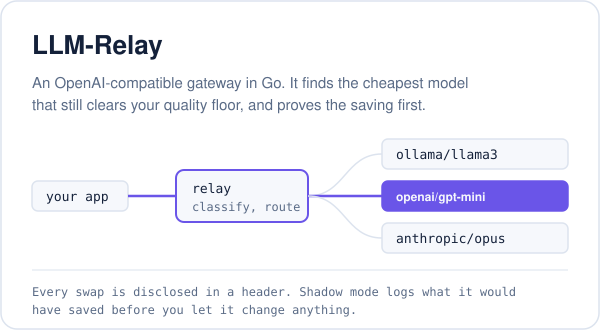
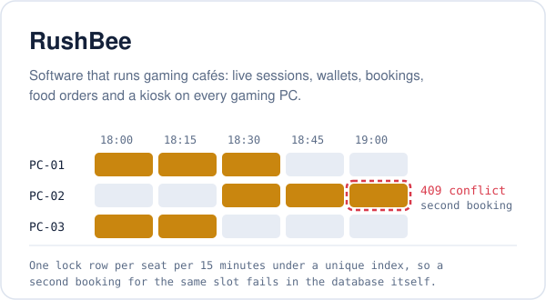

<picture>
  <source media="(prefers-color-scheme: dark)" srcset="assets/banner-dark.svg">
  <source media="(prefers-color-scheme: light)" srcset="assets/banner-light.svg">
  
</picture>

I work on backend systems where a mistake costs someone money or time: billing, bookings, payments and the messages that announce them. I write mostly Go, Java and Node.js, and I care about the boring guarantees: idempotency, locking, retries that don't double-charge, and data you can reconcile to the last paisa.

Outside work I'm building **[RushBee](https://rushbee.app)**, software that runs gaming cafés end to end.

## What I'm building

  <a href="https://github.com/Shashank-Panda/LLM-Relay">
    <picture>
      <source media="(prefers-color-scheme: dark)" srcset="assets/relay-dark.svg">
      <source media="(prefers-color-scheme: light)" srcset="assets/relay-light.svg">
      
    </picture>
  </a>
  <a href="https://rushbee.app">
    <picture>
      <source media="(prefers-color-scheme: dark)" srcset="assets/rushbee-dark.svg">
      <source media="(prefers-color-scheme: light)" srcset="assets/rushbee-light.svg">
      
    </picture>
  </a>

<b>How RushBee is put together</b>

 

RushBee is one multi-tenant Node.js and MongoDB backend that serves a real-time POS for staff, a branded booking site per café and a kiosk app on every gaming PC. A few of the design decisions behind it:

- **Double bookings fail in the database.** Each booking takes one lock row per seat per 15-minute slot under a unique index. A clash is a duplicate-key error, returned as `409`. Checkout, holds, rescheduling and seat closures all share the same locks.
- **Billing can't charge twice.** Session updates take a short lease and only apply if the last-billed time hasn't moved, so a retried heartbeat is a no-op.
- **Wallets work like card payments.** A booking reserves funds, check-in or cancellation releases them, and a no-show is captured exactly once.
- **Messages go through an outbox.** Business code records the event and moves on. A dispatcher claims rows safely across instances, retries with backoff and jitter, and parks repeat failures in a dead-letter state.
- **Each café's secrets are sealed to that café.** AES-256-GCM with the café ID bound into the ciphertext and a key version on every record, so keys rotate without downtime.
- **The kiosk respects the game.** I designed the PC app so that alerts never steal focus. If a game is running in exclusive fullscreen, the alert is spoken instead of drawn.

## Other work

| Project | What it is |
| --- | --- |
| [kafka-messaging-service](https://github.com/Shashank-Panda/kafka-messaging-service) | Spring Boot and Spring Kafka service with Docker and Kubernetes manifests |
| [currency-exchange-grpc](https://github.com/Shashank-Panda/currency-exchange-grpc) | Client and server talking over gRPC in Go |
| [lld-practice](https://github.com/Shashank-Panda/lld-practice) | Low-level design exercises in Java |
| [CRUD_mongoDB](https://github.com/Shashank-Panda/CRUD_mongoDB) | A REST API in Go on the official MongoDB driver |

## Toolbox

<picture>
  <source media="(prefers-color-scheme: dark)" srcset="https://skillicons.dev/icons?i=go%2Cjava%2Cnodejs%2Cts%2Cpy%2Cexpress%2Cspring%2Creact%2Ckafka%2Cmongodb%2Credis%2Cdocker%2Ckubernetes%2Cgcp%2Cprometheus&perline=15&theme=dark">
  <source media="(prefers-color-scheme: light)" srcset="https://skillicons.dev/icons?i=go%2Cjava%2Cnodejs%2Cts%2Cpy%2Cexpress%2Cspring%2Creact%2Ckafka%2Cmongodb%2Credis%2Cdocker%2Ckubernetes%2Cgcp%2Cprometheus&perline=15&theme=light">
  
</picture>

## A year of commits

<picture>
  <source media="(prefers-color-scheme: dark)" srcset="https://raw.githubusercontent.com/Shashank-Panda/Shashank-Panda/output/snake-dark.svg">
  <source media="(prefers-color-scheme: light)" srcset="https://raw.githubusercontent.com/Shashank-Panda/Shashank-Panda/output/snake-light.svg">
  
</picture>

Most of my commits are in private repositories, so the graph above is the honest picture, not the public repo list. The banner and cards are generated by <a href="assets/build.py">assets/build.py</a>.
